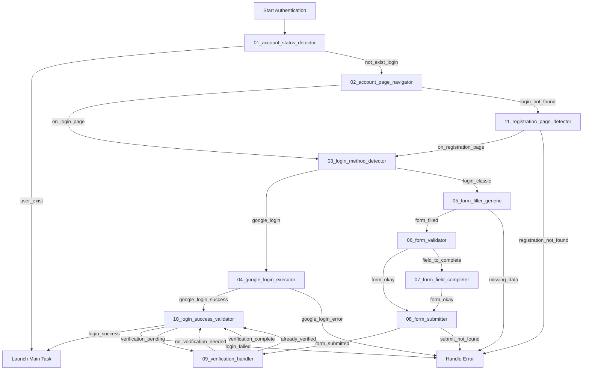

# Multi-Level Authentication System - Architecture

## Overview
This system uses specialized prompts for each authentication sub-task, reducing model complexity and improving reliability.

## Signal Flow Diagram



## Prompt Hierarchy

### Level 1: Account Detection
**01_account_status_detector.py**
- **Purpose**: Detect if user is already logged in
- **Signals**: 
  - `user_exist` → User logged in, go to main task
  - `not_exist_login` → Need to login

### Level 2: Navigation
**02_account_page_navigator.py**
- **Purpose**: Navigate to login/account page
- **Signals**:
  - `on_login_page` → Ready for login
  - `login_not_found` → Try registration page

**11_registration_page_detector.py**
- **Purpose**: Find registration page for new accounts
- **Signals**:
  - `on_registration_page` → Ready to create account
  - `registration_not_found` → Error

### Level 3: Login Method Detection
**03_login_method_detector.py**
- **Purpose**: Identify Google vs Classic login
- **Signals**:
  - `google_login` → Google OAuth available (PRIORITY)
  - `login_classic` → Traditional form login
  - `no_login_method` → Error

### Level 4A: Google Login Flow
**04_google_login_executor.py**
- **Purpose**: Handle complete Google OAuth flow
- **Handles**: Popup, tab switch, account selection, consent
- **Signals**:
  - `google_login_success` → Logged in via Google
  - `google_login_error` → OAuth failed

### Level 4B: Classic Login Flow
**05_form_filler_generic.py**
- **Purpose**: Fill all form fields top-to-bottom
- **Actions**: Radio buttons, text inputs, dropdowns, checkboxes
- **Signals**:
  - `form_filled` → All fields filled
  - `missing_data` → Cannot complete form

**06_form_validator.py**
- **Purpose**: Verify form completion
- **Signals**:
  - `form_okay` → Form complete, ready to submit
  - `field_to_complete[id1,id2,...]` → Missing fields

**07_form_field_completer.py**
- **Purpose**: Fill specific missing fields
- **Input**: List of missing field IDs
- **Signals**:
  - `form_okay` → All missing fields now filled

**08_form_submitter.py**
- **Purpose**: Click submit button
- **Signals**:
  - `form_submitted` → Form sent
  - `submit_not_found` → Cannot find submit button

### Level 5: Post-Submission
**09_verification_handler.py**
- **Purpose**: Handle email/code verification
- **Signals**:
  - `no_verification_needed` → Direct login
  - `verification_complete` → Verification done
  - `already_verified` → Already verified

**10_login_success_validator.py**
- **Purpose**: Confirm successful authentication
- **Signals**:
  - `login_success` → Ready for main task
  - `login_failed` → Authentication failed
  - `verification_pending` → Still waiting

## Execution Flow Examples

### Scenario 1: Existing User with Google Login
```
01_account_status_detector → not_exist_login
02_account_page_navigator → on_login_page
03_login_method_detector → google_login
04_google_login_executor → google_login_success
10_login_success_validator → login_success
→ MAIN TASK
```

### Scenario 2: New User with Classic Login
```
01_account_status_detector → not_exist_login
02_account_page_navigator → login_not_found
11_registration_page_detector → on_registration_page
03_login_method_detector → login_classic
05_form_filler_generic → form_filled
06_form_validator → field_to_complete[A,C]
07_form_field_completer → form_okay
08_form_submitter → form_submitted
09_verification_handler → verification_complete
10_login_success_validator → login_success
→ MAIN TASK
```

### Scenario 3: Already Logged In
```
01_account_status_detector → user_exist
→ MAIN TASK
```

## Key Design Principles

1. **Single Responsibility**: Each prompt has ONE specific task
2. **Minimal Action Space**: Only relevant actions available per prompt
3. **Clear Signals**: Explicit signal-based communication between prompts
4. **Sequential Execution**: One prompt per task execution loop
5. **Reusability**: Form filling prompts work for both login and registration
6. **Error Handling**: Clear error signals for orchestration layer

## Implementation Notes

- Each prompt is a separate file in `agent/prompts/raw/`
- Prompts use the same format as existing prompts (dict with template, meta_data)
- Signals are returned via `finish("signal_name")`
- The orchestration layer (to be implemented) manages signal routing
- User persona data flows through all prompts that need it
